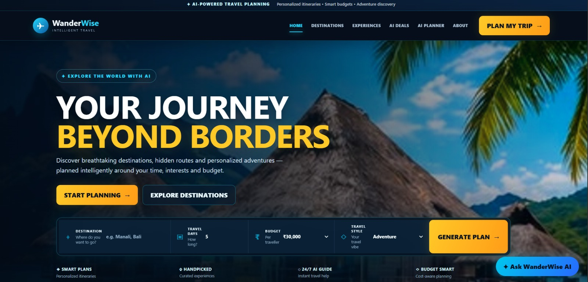
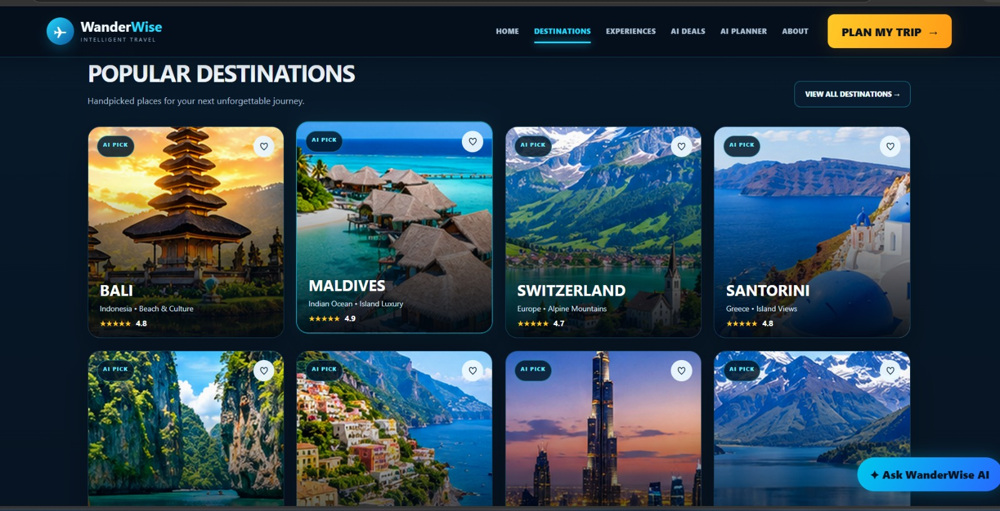
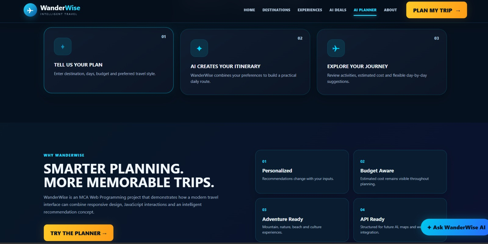
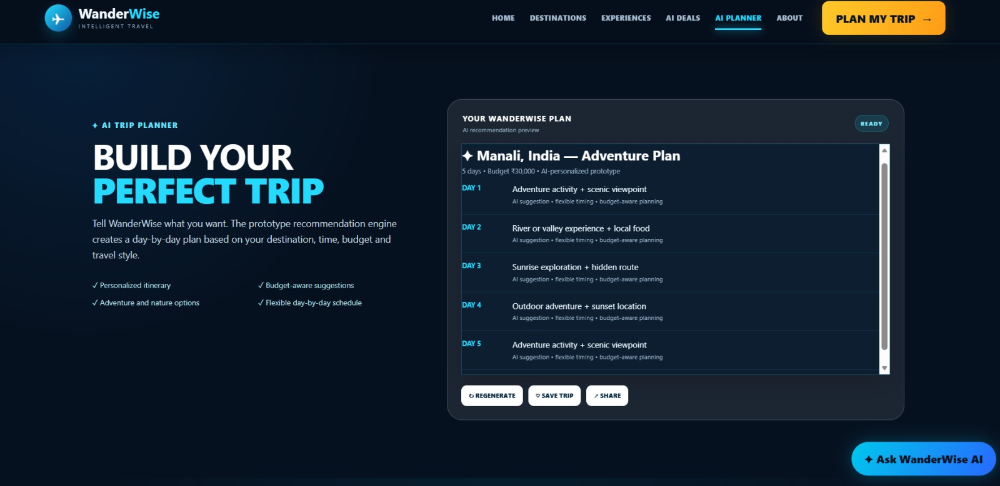
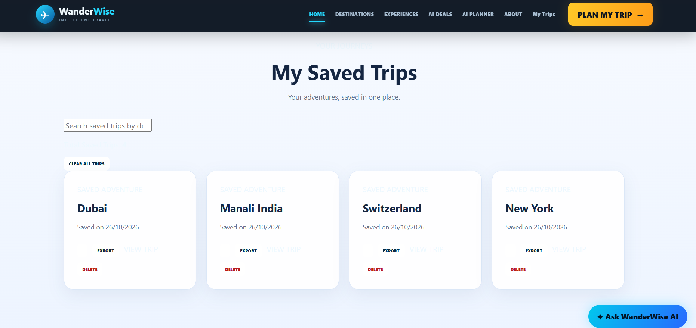

# 🌍 WanderWise – Intelligent Travel Planning System

A beginner-friendly web programming project for exploring destinations and organizing sample travel itineraries.

**Student:** Aditya Pratap Singh  
**UID:** 26MCA20201  
**Program:** MCA General  
**University:** Chandigarh University

## 🔗 Project Links

- **Live Website:** https://adityaps14.github.io/wanderwise-travel-planner-webprogramming/
- **Source Code:** https://github.com/adityaps14/wanderwise-travel-planner-webprogramming

## 📌 About the Project

WanderWise is a web-based travel-planning demonstration designed to help users explore destinations and organize basic trip preferences through a simple interface. Depending on the available features, users can enter details such as destination, trip duration, budget, and travel style to view sample itinerary suggestions.

This project was developed as part of practical learning in web programming.

## 🎯 Objectives

- Create a user-friendly travel-planning website.
- Present travel destinations with images and information.
- Practise HTML, CSS, and JavaScript.
- Demonstrate interactive trip-planning functionality.
- Publish a static website using GitHub Pages.

## ✨ Features

- Travel destination sections and image cards.
- Responsive webpage layout.
- Trip-planning inputs, where implemented.
- Sample itinerary suggestions using front-end JavaScript logic.
- Static website deployment through GitHub Pages.

> Note: The current version is a front-end demonstration. It does not provide live flight or hotel booking, payment processing, a connected database, or a real generative AI service.

## 🖼️ Screenshots

### Homepage


### Destinations


### Trip Planner


### Sample Itinerary


## 📸 Project Screenshots

### Save Trip Plan


If a feature is not implemented or a screenshot is unavailable, remove that image section until you can provide a genuine screenshot.

## 🛠️ Technologies Used

- **HTML5:** Page structure and content.
- **CSS3:** Styling, layout, and responsive design.
- **JavaScript:** Front-end interactions and sample planning logic.
- **GitHub:** Source-code hosting and version control platform.
- **GitHub Pages:** Static website hosting.

## 📁 Project Structure

```text
wanderwise-travel-planner-webprogramming/
├── assets/                 # Website images
├── screenshots/            # Project screenshots
├── index.html              # Main webpage
├── style.css               # Styles and responsive layout
├── script.js               # Interactive functionality
├── README.md               # Project documentation
├── LICENSE.txt             # License information
└── .nojekyll               # GitHub Pages configuration
```

## 🚀 How to View the Project

### Online
Open the live website:
https://adityaps14.github.io/wanderwise-travel-planner-webprogramming/

### Run Locally
1. Download or clone this repository.
2. Keep the HTML, CSS, JavaScript, and assets in their expected locations.
3. Open `index.html` in a modern web browser.
4. Test the navigation, planner inputs, and other available interactions.

You can also open the folder in Visual Studio Code and use a local web-server extension if needed.

## 🧪 Testing Checklist

- [ ] Website opens successfully.
- [ ] Navigation links work correctly.
- [ ] Destination images load properly.
- [ ] Planner inputs accept the expected values.
- [ ] Sample itinerary displays correctly, if implemented.
- [ ] Layout works on desktop and mobile.
- [ ] All screenshots display correctly in this README.


## ⚠️ Current Limitations

- No connected backend or database.
- No live flight or hotel booking.
- No live pricing or weather integration.
- No real AI API integration in the current version.

## 🔮 Future Enhancements

- Integrate a real AI recommendation service.
- Add a database for saved trips.
- Add live weather and map integrations.
- Connect to legitimate travel information and booking services.
- Improve accessibility and validation.

## 🎓 Academic Information

**Project:** WanderWise – Intelligent Travel Planning System  
**Student:** Aditya Pratap Singh  
**UID:** 26MCA20201  
**Program:** MCA General  
**Institution:** Chandigarh University

## 📄 License

Refer to `LICENSE.txt` for the license associated with this project.
